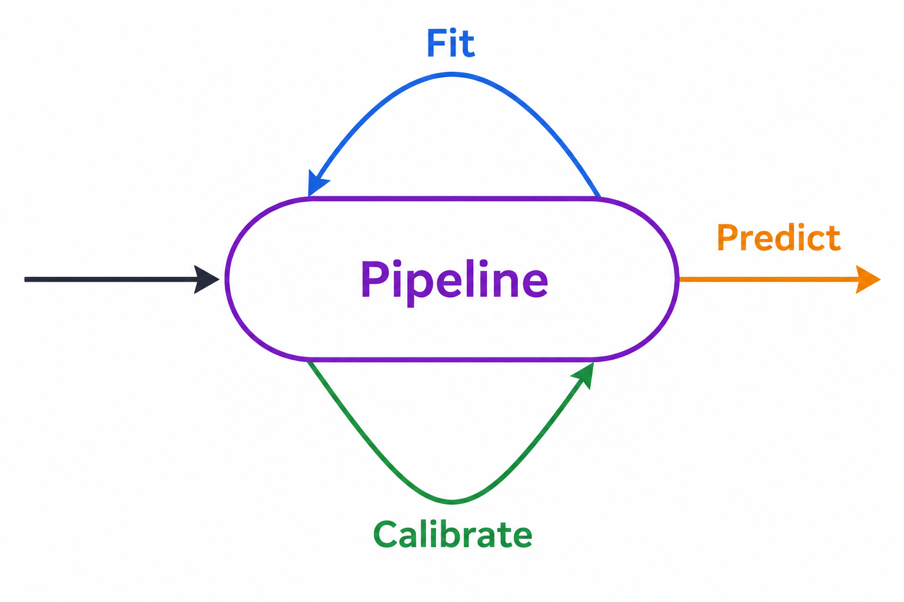

<div align="center">

# 🧲 DELT

### **Zero-shot and Few-shot Multimodal Classification with Label Tuning**

A toolkit for zero-shot, label tuning, and distillation with dual encoders.

[](LICENSE)
[](CODE_OF_CONDUCT.md)


</div>

---

## 👋 DELT

Applications where embeddings serve as persistent representations—such as semantic search, recommendation, document ranking, and RAG—benefit from efficient zero-shot classification based on similarities between input and label embeddings, enabling personalized retrieval. However, adapting these representations to evolving user preferences typically requires retraining the underlying encoder. Label tuning offers an efficient alternative by adapting only the label embeddings, enabling the reuse of precomputed embeddings. `delt` allows you to operationalize label tuning in embedding-based applications, supporting:

- 🚀 Perform **zero-shot classification** without training data.
- 🎯 Fine-tune classifiers using only a few labeled examples through **label tuning**.
- 🌍 Work across **text (& spans), images, audio, and video** using a unified API.
- ⚡ Train in seconds by optimizing only lightweight label embeddings.
- 💻 Run inference efficiently on CPU once embeddings are available.
- 🤖 Distill powerful LLMs and multimodal models into compact, production-ready classifiers.
- ⚖️ Post-hoc calibration of label tuning models easily to trust on probabilities.

Whether you have **zero**, **ten**, or **thousand** annotated samples, `delt` provides a simple pipeline that scales with your data.

<p align="center">
  <br>
  <strong>Figure 1.</strong> DELT diagram.
</p>

# ✨ How it works

`delt` is built around **dual-encoder embedding models**, supporting **zero-shot** classification and finetuning through **label tuning**.

If you have no annotated data, `delt` performs zero-shot classification directly using pretrained embedding models, that is: no optimization, no gradient updates, no training loop, simply define your labels and start predicting.

When a labeled dataset is available (few data or a large volume), `delt` optimizes the label embeddings through **label tuning** while keeping the encoder frozen. This offers embedding reusability, dramatically fewer trainable parameters, faster training, smaller deployment artifacts, and competitive accuracy, making it especially suitable for embedding-based applications where embeddings are precomputed—such as retrieval-augmented generation (RAG) systems, visualization tools, and semantic search pipelines. The idea is simple and was originally proposed in (Müller Thomas, et al., 2022) and has been here extended for multimodal dual encoders:

Given a sentence like

> *"I love this movie."*

and the label

> *"positive"*

`delt` finetunes label embeddings computed from pretrained embedding models such that

```
❄️embedding("I love this movie")❄️ ≈ 🔥embedding("This review is positive")🔥
```

where ❄️ and 🔥 refer to frozen and trainable parameters. Unlike traditional training methods, the encoder remains frozen while only the label representations are optimized. In practice, the trainable component contains only (number_of_labels × embedding_dimension) parameters, making label tuning remarkably efficient while preserving the knowledge of the original embedding model.

When human-annotated data is unavailable and zero-shot methods do not deliver sufficient performance, delt provides distillation as an alternative. It supports both **soft distillation**, where label embeddings are fine-tuned to match the probability distribution produced by more powerful but computationally expensive models, and **hard distillation**, where label embeddings are fine-tuned to reproduce the labels predicted by models that do not provide class probabilities (e.g., LLMs, LMMs, and Jev).
This approach enables knowledge from highly capable models to be compressed into a relatively small set of parameters, making it practical to deploy their capabilities in large-scale applications where running an LLM or LMM on every example would be prohibitively expensive. You can just select a random set of your million documents, annotate it with an LLM, train a model with `delt`, and predict all the remaining data with your brand new model in a more efficient way.

# 🚀 Supported modalities

`delt` provides ready-to-use encoders for every modality. However, you're also free to use precomputed embeddings instead.

<table align="center">
  <thead>
    <tr>
      <th>Modality</th>
      <th>Provided encoders</th>
    </tr>
  </thead>
  <tbody>
    <tr><td>🈳 Text (&amp; spans)</td><td>Sentence Transformers</td></tr>
    <tr><td>🖼 Image</td><td>CLIP, SigLIP, SigLIP2</td></tr>
    <tr><td>🔊 Audio</td><td>CLAP, GLAP</td></tr>
    <tr><td>🎥 Video</td><td>X-CLIP</td></tr>
  </tbody>
</table>

Every modality follows exactly the same workflow, so learning one modality means learning them all:

<p align="center">
  <br>
  <strong>Figure 2.</strong> A pipeline in delt works in the same way for every modality.
</p>


# 📦 Installation

You can install `delt` using as:

```bash
uv add deltpy
```

For some cases such as hard distillation with LLMs, LMMs, or Jev, you will need environment variables depending on the model and provider you use:

```bash
OPENAI_API_KEY=...
GEMINI_API_KEY=...
OPENROUTER_API_KEY=...
TYPESAFE_API_KEY=...
```

> 🎧 **On FFmpeg issues**
>
> `ffmpeg` is required for audio processing by `libtorchcodec`, which is used by the audio processors. Please install an `ffmpeg` version compatible with `torchaudio==2.10.0`. Versions 4, 5, 6, 7, and 8 are supported.
> Make sure `ffmpeg` is correctly installed and available in your `PATH` so that Torch can load it properly.
> MacOS users: if you installed `ffmpeg` through `homebrew` with a versioned formula, please, add the versioned path to your `zshrc` file, e.g., `export DYLD_FALLBACK_LIBRARY_PATH=/opt/homebrew/opt/ffmpeg@8/lib` and create a symlink as `ln -s /opt/homebrew/opt/ffmpeg@8 /opt/homebrew/opt/ffmpeg`

# 🚀 Pipeline

The API is intentionally minimal. For examples of how to use `delt` for every modality, take a look to the [pipeline examples folder](examples/pipelines).

The following snippet shows how to use the `TextPipeline`, and the same design applies to every other supported modality.

```python
from delt import TextPipeline

# Instantiate the pipeline
label_verbalizations = {
    "positive": "really positive",
    "negative": "really negative",
}
prompt_template = "This text is {}"
encoder_class = "sentence-transformer"
encoder_name = "sentence-transformers/all-MiniLM-L6-v2"
pipeline = TextPipeline(
    encoder_name, encoder_class, label_verbalizations, prompt_template
)

# Zero-shot prediction
test_texts = ["I don't like you"]
preds = pipeline.predict(test_texts, batch_size=8)

# Label-tuning training
training_texts = ["I'm happy", "I'm sad", "You're strong", "I hate you."]
training_truths = ["positive", "negative", "positive", "negative"]
training_output = pipeline.fit(training_texts, training_truths)

# Calibrate
calibration_texts = ["You are soooo good", "You are soooo bad"]
calibration_truths = ["positive", "negative"]
calibrator = pipeline.calibrate(calibration_texts, calibration_truths)

# Predict after training
preds = pipeline.predict(test_texts, batch_size=8)

# Evaluate
test_truths = ["negative"]
results = pipeline.evaluate(test_texts, test_truths, batch_size=8)

# Save the pipeline
pipeline.save("checkpoints/my-text-model")

# Load the pipeline and predict again
pipeline = TextPipeline.load("checkpoints/my-text-model")
preds = pipeline.predict(test_texts, batch_size=8)
```

# ⚡ Label tuning
If you already have precomputed embeddings and annotations, you can use the `EmbeddingPipeline` to train label embeddings and perform inference.

```python
import torch
from delt import EmbeddingPipeline

# Instantiate the pipeline
label_embeddings = torch.vstack(
    [torch.randn(1, 16) - 3, torch.randn(1, 16) + 3]
)
pipeline = EmbeddingPipeline(
    label_embeddings, label_names=["negative", "positive"]
)

# Zero-shot prediction
test_embeddings = torch.vstack(
    [torch.randn(2, 16) - 3, torch.randn(2, 16) + 3]
)
preds = pipeline.predict(test_embeddings, batch_size=8)

# Label-tuning training
training_embeddings = torch.vstack(
    [torch.randn(5, 16) - 3, torch.randn(5, 16) + 3]
)
training_truths = ["negative"] * 5 + ["positive"] * 5
training_output = pipeline.fit(
    training_embeddings, training_truths, do_cv=False
)

# Predict after training
preds = pipeline.predict(test_embeddings, batch_size=8)

# Calibrate the probabilities with held-out data
calibration_embeddings = torch.vstack(
    [torch.randn(5, 16) - 3, torch.randn(5, 16) + 3]
)
calibration_truths = ["negative"] * 5 + ["positive"] * 5
calibrator = pipeline.calibrate(
    calibration_embeddings, calibration_truths, method="beta"
)

# Predict after calibration
preds = pipeline.predict(test_embeddings, batch_size=8)

# Evaluate
test_truths = ["negative"] * 2 + ["positive"] * 2
results = pipeline.evaluate(test_embeddings, test_truths, batch_size=8)

# Save the pipeline
pipeline.save("checkpoints/my-embedding-model")

# Load the pipeline and predict again
pipeline = EmbeddingPipeline.load("checkpoints/my-embedding-model")
preds = pipeline.predict(test_embeddings, batch_size=8)
```

# 🧩 Span detection and classification
`delt` supports span detection and classification such as NER or aspect-based sentiment analysis by computing similarities between templated label verbalizations and spans of fixed width. Each text is encoded once, and each candidate is embedded as the mean of its contextual token embeddings and classified against the label embeddings, plus a trainable "none" class for candidates that are not spans of interest. Predicted spans never overlap.

Training is essential for achieving good performance on span classification tasks, as most embedding models are not designed to produce meaningful token embeddings at specific positions without fine-tuning.

```python
from delt import SpanPipeline
from delt.pipelines.text import PredictedSpan, SpanAnnotation

# Define some helper functions
def show_outputs(texts: list[str], preds: list[list[PredictedSpan]]):
    """Print the predicted spans for each text."""
    for text, spans in zip(texts, preds, strict=True):
        print(
            text,
            [(s.text, s.label, round(s.score, 2)) for s in spans],
        )

def annotate(texts: list[str], gold: list[list[tuple[str, str]]]):
    """Convert (phrase, label) pairs into span annotations."""

    def annotate_span(text: str, phrase: str, label: str) -> SpanAnnotation:
        start = text.index(phrase)
        return SpanAnnotation(start, start + len(phrase), label)

    return [
        [annotate_span(text, phrase, label) for phrase, label in spans]
        for text, spans in zip(texts, gold, strict=True)
    ]

# Instantiate the pipeline
label_verbalizations = {
    "person": "a person's name",
    "location": "a city, country or place",
    "organization": "a company or organization name",
}
prompt_template = "This is {}"
encoder_class = "sentence-transformer"
encoder_name = "sentence-transformers/all-MiniLM-L6-v2"
pipeline = SpanPipeline(
    encoder_name,
    encoder_class,
    label_verbalizations,
    prompt_template,
    max_span_width=8,
    negative_ratio=3,
)

# Zero-shot prediction
test_texts = [
    "Laura works for IBM in Dublin.",
    "Nokia opened a lab in Helsinki.",
]
preds = pipeline.predict(test_texts, batch_size=8, threshold=0.8)
show_outputs(test_texts, preds)

# Label-tuning training
train_texts = [
    "Alice visited Paris last summer.",
    "Bob moved to Berlin in March.",
    "Carol flew from Madrid to Rome.",
    "David lives in London with Eve.",
    "TransPerfect is located in Barcelona and it's aimed to translation and regionalization.",
    "Google hired Maria to work on search in Zurich.",
]
train_annotated_spans = [
    [("Alice", "person"), ("Paris", "location")],
    [("Bob", "person"), ("Berlin", "location")],
    [("Carol", "person"), ("Madrid", "location"), ("Rome", "location")],
    [("David", "person"), ("London", "location"), ("Eve", "person")],
    [("TransPerfect", "organization"), ("Barcelona", "location")],
    [("Google", "organization"), ("Maria", "person"), ("Zurich", "location")],
]
train_truths = annotate(train_texts, train_annotated_spans)
training_output = pipeline.fit(train_texts, train_truths)

# Predict after training
preds = pipeline.predict(test_texts, batch_size=8, threshold=0.8)
show_outputs(test_texts, preds)

# Evaluate
test_annotated_spans = [
    [("Laura", "person"), ("IBM", "organization"), ("Dublin", "location")],
    [("Nokia", "organization"), ("Helsinki", "location")],
]
test_truths = annotate(test_texts, test_annotated_spans)
results = pipeline.evaluate(
    test_texts, test_truths, batch_size=8, threshold=0.8
)

# Save the pipeline
pipeline.save("checkpoints/my-span-model")

# Load the pipeline and predict again
pipeline = SpanPipeline.load("checkpoints/my-span-model")
preds = pipeline.predict(test_texts, batch_size=8, threshold=0.8)
show_outputs(test_texts, preds)
```

# 🧪 Distillation

Instead of manually annotating thousands of examples, a stronger model can act as a **teacher**, while `delt` learns a lightweight **student**.

Both **soft** and **hard** distillation are supported by `delt` for every modality, including text span classification. You can take a look to the [soft distillation](examples/soft_distillation/) and [hard distillation](examples/hard_distillation/) folders to see how it works. 

## 💪🧪 Hard distillation
In hard distillation, the teacher model outputs labels without probabilities. `delt` can use these labels as silver labels to train a student model. Here we show an example to distill `gpt-5.4-nano` into label embeddings for a sentiment analysis task (hard-distillation):

```python
from delt.pipelines import TextPipeline
from delt.teachers import LLMTextTeacher

# Define your input data and label set
texts = ["I hate you", "I love you"]
label_set = ["positive", "negative"]

# Instantiate the teacher model
teacher = LLMTextTeacher(
    "gpt-5.4-nano",
    {"temperature": 0},
    "Classify the following text into positive or negative for a sentiment analysis task.",
)

# Generate the labels (`predict`) or probs (`predict_proba`)
truths = teacher.predict(texts, label_set)

# Create the label verbalizations (same order as the label set)
label_verbalizations = {
    "positive": "really positive",
    "negative": "really negative",
}

# Set the encoder
prompt_template = "This text is {}"
encoder_class = "sentence-transformer"
encoder_name = "sentence-transformers/all-MiniLM-L6-v2"

# Instantiate the pipeline
pipeline = TextPipeline(
    encoder_name, encoder_class, label_verbalizations, prompt_template
)

# Zero-shot prediction
preds = pipeline.predict(texts, batch_size=8)

# Label-tuning to train the student model
training_output = pipeline.fit(texts, truths)

# Prediction after training
preds = pipeline.predict(texts, batch_size=8)
```

## 🪶🧪 Soft distillation
In soft distillation, the teacher is required to compute probabilities. Although these probabilities cannot be extracted from many high-performing closed-source models, some may still be suitable for soft distillation (e.g., Jev), alongside open-source models available on Hugging Face, provided that they achieve reasonably good performance on our downstream task.

Those teachers in `delt` whose `predict_proba` returns a not one-hot probability distribution can be used for soft distillation. The following example shows how to distill from Jev's probabilities.

```python
import os
from delt.pipelines import TextPipeline
from delt.teachers import JevTextTeacher

# Define your input data and label set
texts = ["I hate you", "I love you"]
label_set = ["positive", "negative"]

# Instantiate the teacher model (through OpenRouter, although any provider is supported)
teacher = JevTextTeacher(
    "jev-latest",
    "What is the sentiment of this text?",
    "User text: {}",
    base_url="https://openrouter.ai/api",
    api_key=os.environ["OPENROUTER_API_KEY"],
)

# Generate the labels (`predict`) or probs (`predict_proba`)
truth_probas = teacher.predict_proba(texts, label_set)

# Create the label verbalizations (same order as the label set)
label_verbalizations = {
    "positive": "really positive",
    "negative": "really negative",
}

# Instantiate the pipeline
prompt_template = "This text is {}"
encoder_class = "sentence-transformer"
encoder_name = "sentence-transformers/all-MiniLM-L6-v2"
pipeline = TextPipeline(
    encoder_name, encoder_class, label_verbalizations, prompt_template
)

# Zero-shot prediction
preds = pipeline.predict(texts, batch_size=8)

# Label-tuning to train the student model
training_output = pipeline.fit(texts, truth_probas)

# Prediction after training
preds = pipeline.predict(texts, batch_size=8)
``` 

# 📦 Deploying a label tuned model

A trained pipeline can be saved to a directory with `save`, and restored with `load`. For instance:

```python
from delt import EmbeddingPipeline

label_embeddings = torch.vstack(
    [torch.randn(1, 16) - 3, torch.randn(1, 16) + 3]
)
pipeline = EmbeddingPipeline(
    label_embeddings, label_names=["negative", "positive"]
)
pipeline.save("my_model")
pipeline = EmbeddingPipeline.load("my_model")
```

The output directory contains:
- `label_embeddings.safetensors`: the `label_embeddings` and `logit_scale` tensors, loadable with `safetensors.torch.load_file`.
- `model.json`: the label names, the training information (hyperparameters, number of samples, training time, loss), the validation performance (accuracy, expected calibration error, macro/weighted F1 and metrics per label), the calibrator (if `calibrate` was used), and, any other information required to rebuild the pipeline. 

# 🖥 User Interface

`delt` ships with a lightweight Streamlit application for experimentation.

```bash
uv run streamlit run src/delt/ui/app.py
```

<p align="center">
  <br>
  <strong>Figure 3.</strong> <code>delt</code> playground.
</p>

# 📚 How to cite

`delt` extends the label tuning strategy, introduced in (Müller Thomas, et al., 2022), for multimodal dual encoders. If `delt` contributes to your research, please consider citing the original paper and this repository:

```bibtex
@inproceedings{muller-etal-2022-shot,
    title = "Few-Shot Learning with {S}iamese Networks and Label Tuning",
    author = {M{\"u}ller, Thomas  and
      P{\'e}rez-Torr{\'o}, Guillermo  and
      Franco-Salvador, Marc},
    editor = "Muresan, Smaranda  and
      Nakov, Preslav  and
      Villavicencio, Aline",
    booktitle = "Proceedings of the 60th Annual Meeting of the Association for Computational Linguistics (Volume 1: Long Papers)",
    month = may,
    year = "2022",
    address = "Dublin, Ireland",
    publisher = "Association for Computational Linguistics",
    doi = "10.18653/v1/2022.acl-long.584",
    pages = "8532--8545",
}

@software{delt,
  author       = {González, José Ángel and Aymo, Mahmoud and Bane, Fred},
  title        = {DELT: A Python Library for Multimodal Label Tuning},
  year         = {2026},
  publisher    = {GitHub},
  url          = {https://github.com/jogonba2/delt},
  version      = {main}
}
```


# 🤝 Contributing

Contributions are always welcome. Please make sure to:

- Install the development dependencies
- Format your code before submitting as `./dev-tools/format.sh`
- Lint your code before submitting as `./dev-tools/lint.sh`
- Run the test suite as `./dev-tools/test.sh`
- Follow the project's coding standards
- Open discussions for larger feature proposals
